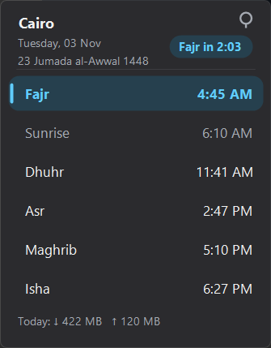
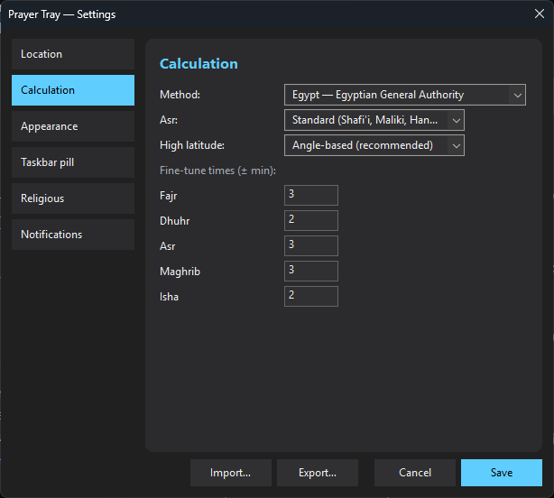

<div align="center">


# PrayerTray

Prayer times on your Windows taskbar.

[](../../releases/latest)
[](../../releases)
[](LICENSE)

**[Download PrayerTray-win-x64.exe](../../releases/latest)** · Windows 10 / 11 · ~3.5 MB · no install




</div>

## Features

- **Taskbar pill**: next prayer and a live countdown. Click it for the full day.
- **Reminders & azan**: a heads-up before each prayer; Makkah, Madinah or your own adhan.
- **Stays quiet**: mutes the azan during calls, games and Do not disturb.
- **Hijri calendar**: Hijri date, Islamic events, Sunnah-fast and Friday reminders.
- **Optional meters**: network speed, ping, CPU/RAM, data usage, VPN.
- **Fully offline**: the network is used only for location detect and update checks.
- **6 languages**: English, العربية, Français, Türkçe, اردو, Indonesia (RTL-aware).

> **SmartScreen warning?** The exe isn't signed. Click **More info → Run anyway**.

## Settings

Right-click the pill → **Settings**. Pick your location (auto-detect or map), calculation method
(MWL, ISNA, Egypt, Makkah, Karachi), Asr school, and per-prayer minute tweaks.



## Build

```powershell
cd rust
cargo build --release   # needs MSVC Build Tools + Windows SDK
```

Internals: [`docs/ARCHITECTURE.md`](docs/ARCHITECTURE.md)

## License

[MIT](LICENSE)
